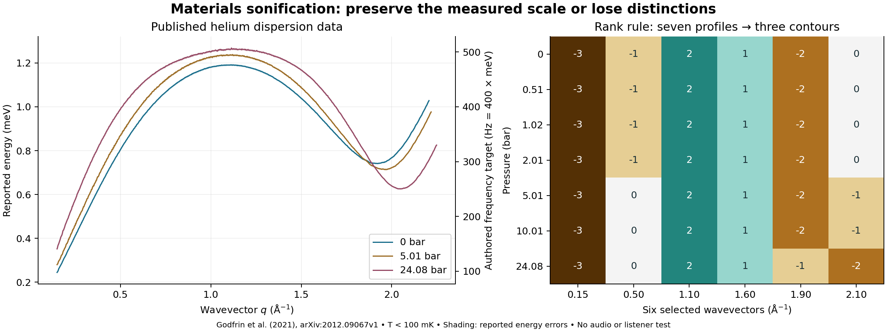

# MAT-SPEC-001 v1.0.0

## Measured helium spectra and sonification preservation

Prepared for DOI **10.5281/zenodo.24062652**. This profile implements the first
physical-data adapter motivated by
[SONIFICATION-MATERIALS-FEASIBILITY-001](materials/FEASIBILITY.md).
It is independently versioned from ETQ-303 and D4-TIA. The earlier feasibility
note is retained as a historical exploratory result; its statements about
future implementation describe its own creation time.

The implementation uses the Python 3.11+ standard library, runs offline and
never imports the repository's music synthesis laboratories. Filesystem export
requires POSIX directory-descriptor and no-follow support, as on Linux.

## Data and scientific scope

The source is Godfrin et al., *The dispersion relation of Landau elementary
excitations and the thermodynamic properties of superfluid 4He*, Physical Review
B 103, 104516 (2021), DOI [10.1103/PhysRevB.103.104516](https://doi.org/10.1103/PhysRevB.103.104516),
[arXiv:2012.09067v1](https://arxiv.org/abs/2012.09067v1).

The original ancillary table, its attribution and metadata are in
[`data/materials/helium4`](../data/materials/helium4). Its SHA-256 is
`15a56ccdd2f681de0e1d3d1517dc4641732dbef4e2d6153591154cc4b039b50a`.
The unmodified UTF-16 file is redistributed under CC BY 4.0 with attribution.
New implementation code is MPL-2.0; new research prose and derived data are
CC BY 4.0. The original authors are the data providers, not coauthors of this
new implementation.

Seven pressures, nominally 0, 0.51, 1.02, 2.01, 5.01, 10.01 and 24.08 bar, share
1,050 q positions from 0.150 to 2.248 inverse angstroms in steps of 0.002. The
table contains 7,118 valid energy/error pairs and 232 missing pairs. These are
processed published data, not independent new measurements or raw detector
counts. The paper reports temperatures below 100 mK; this is dataset-level
context, not a separate temperature reading for each row. All conditions are
in the superfluid regime. This profile cannot establish a normal-to-superfluid
transition, an absolute-zero measurement, or E8 symmetry in helium.

## Frozen mapping contract

[`spec/mat-spec-001.v1.json`](../spec/mat-spec-001.v1.json) and the source metadata
are hash-pinned alongside the raw table. Their values cannot silently drift
away from the implemented mapping. Changing the configuration requires a
deliberate profile revision and corresponding validation.

| Receiver | Rule | Preserved / lost |
|---|---|---|
| Common scale | f = 400 E, with E in meV and f in Hz | Exact represented values, energy ratios and scaled reported errors; the factor is authored |
| Rank contour | Dense ascending rank minus floor(distinct-count/2), added to MIDI note 60 | Equality and order within each six-point profile; magnitudes and ratios discarded |
| Quantized MIDI | Nearest 12-TET note, A4 = 440 Hz; no pitch bend | Approximate pitch; rounding error is measured; distinct values can collide |

Exactness refers to rational arithmetic on the published decimal strings.
Physical measurement errors remain. The frequency scale is not the unscaled
quantum transition frequency E/h, nor a unique naturally audible material sound.
The common-scale receiver is represented in JSON/CSV; the quantized MIDI file
does not claim to reproduce its exact frequencies.

MIDI note selection compares exact rational 24th powers against the geometric
midpoints between notes. It does not use floating logarithms for note decisions.
Ties go upward, and out-of-range frequencies fail instead of being clamped.
Signed cents errors use 60-digit Decimal calculations rounded to nine decimal
places. They describe the stipulated A440 tuning, not an actual synthesizer.

Missing rows retain pressure/q and explicit status with null numerical outputs;
there is no interpolation or zero substitution. The mapping API represents
zero energy as an unpitched target and emits no MIDI note-on for it; zero is not
present in the pinned measurements. Negative energies and negative reported
errors are rejected. Reported errors use the same 400 scale; no distribution,
confidence level, independence or covariance is assumed.

## Matched six-point comparison

The frozen selection is q = 0.150, 0.500, 1.100, 1.600, 1.900 and 2.100 inverse
angstroms. It spans features of the published dispersion curve. It is an
authored selection made in the feasibility study, not a preregistered experiment
or a claim about every point in the complete spectrum.

Both MIDI files encode 42 note-on/note-off pairs in the same order, with the
same velocity, channel, program and duration. Pressure blocks are sequential.
The timeline uses 480 ticks per quarter, 500,000 microseconds per quarter,
240 ticks between samples, 180-tick notes and 1,920-tick pressure blocks.
This is a presentation clock, not physical evolution time. Program 0 does not
fix an instrument's actual timbre. No MIDI rendering or listening was performed.

For this selection, the common-scale controls retain seven distinct profiles,
the quantized MIDI controls yield six, and the rank controls yield three.
The 0 and 0.51 bar profiles coincide after MIDI rounding. These are numerical
control-sequence distinctions; they are not measured listener discrimination.

The rank contours reproduce the feasibility result:

| Pressures (bar) | Six rank offsets |
|---|---|
| 0, 0.51, 1.02, 2.01 | -3, -1, 2, 1, -2, 0 |
| 5.01, 10.01 | -3, 0, 2, 1, -2, -1 |
| 24.08 | -3, 0, 2, 1, -1, -2 |



## Runtime files and reproduction

```bash
uv run --no-project python -m unittest discover -s tests -p test_mat_spec.py -v
uv run --no-project python scripts/build_mat_spec.py --out dist/mat-spec-001
```

`python` can replace `uv run --no-project python` when an appropriate interpreter
is already selected. No dependencies are installed by the profile itself.
`--source` accepts a byte-identical copy of the pinned dataset. This version does
not accept arbitrary material CSV files or silently infer their units.

| File | Contents |
|---|---|
| contract.json | Frozen mapping and claim boundary |
| observations.json | Attributed source metadata and all 7,350 positions, with exact controls and MIDI rounding errors |
| events.csv | The 42 selected events with source values and all three receiver controls |
| rank.mid | Standard MIDI format 0 rank-contour comparison |
| quantized.mid | Standard MIDI format 0 common-scale-to-12-TET comparison |
| audit.json | Preservation counts, collisions, numerical controls and explicit untested claims |
| manifest.json | SHA-256 identities of every input, output and output-defining implementation file |

Canonical JSON sorts keys, uses ASCII escapes and compact separators, rejects
NaN and ends with LF. Physical decimals/rationals are strings. Core artifacts
exclude clocks, absolute paths and machine-specific version strings. The
manifest excludes its own hash to avoid a cycle; the publication checksum list
binds the manifest. Source hashes identify bytes and provenance, not truth.

The build refuses an existing destination, path traversal and symlink ancestors.
Writes use anchored directory descriptors so replacing the directory with a
symlink cannot redirect writes. A failed build may leave a partial new directory
for inspection; it does not overwrite or clean up unrelated paths. Input reads
reject symlink leaves, non-regular files and files larger than 1 MiB. Requests
for `--render-audio` or `--format wav` fail explicitly. No PCM/audio buffers are
created in memory, temporary files or tests. Runtime output remains `.json`,
`.csv` and `.mid`; publication documents and figures are separate.

## Executed checks and controls

- 7,118 exact energy/error roundtrips and ratios to each pressure's first valid point.
- 105 within-profile pairwise equality/order comparisons across the selected points.
- A positive factor-two energy control: common-scale targets double while ranks remain unchanged.
- A reverse-q-association control: the energy multiset stays fixed while the ordered contour changes.
- Reported-error interval overlap counts, without interpreting them as confidence intervals.
- Per-point MIDI quantization errors and six-point collisions.
- A synthetic golden-ratio benchmark versus an 8/5 comparator: different ratios can become the same eight-semitone interval. This is not a reanalysis of cobalt-niobate observations.
- Independent MIDI decoding checks event pitches, timing, duration, velocity, tempo and chunk structure against CSV.
- Byte-for-byte replay and source/configuration/implementation/output provenance checks.
- Failure checks for source drift, mislabelled units, special files, unsupported audio, traversal, overwriting and symlink replacement.

The original E8 benchmark is Coldea et al., *Science* 327, 177 (2010),
[arXiv:1103.3694](https://arxiv.org/abs/1103.3694). Its emergent low-energy E8
description is separate from the Lorentz/gauge embedding obstruction studied
by Distler and Garibaldi, [arXiv:0905.2658v3](https://arxiv.org/abs/0905.2658v3).
The latter is a theoretical consistency constraint, not a listening control.

## Next experiments

Add independent temperature-series data and a phase diagnostic before making
phase-discrimination claims. Add measured cobalt-niobate response data and
alternative physical models before claiming an E8 recognition test. Predeclare
receiver settings and listening comparisons, use blinded presentation and
held-out observations, and measure discrimination with uncertainty. The five
order-zero D4 covariants remain separate mathematical controls. No physical
mapping from those covariants to helium states has been established here.
